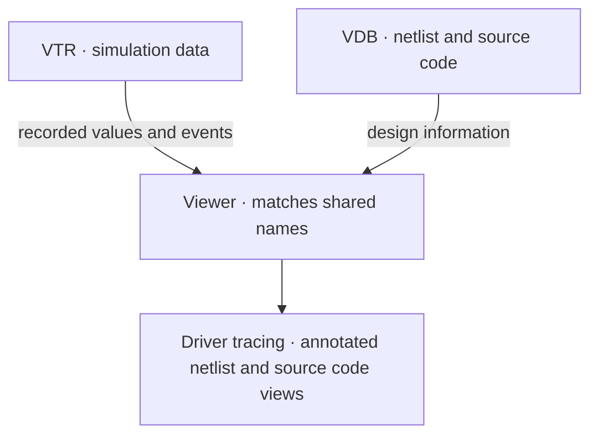

# VTR — Versatile Trace Record

**VTR (Versatile Trace Record)** is a hardware simulation trace format that combines
signal waveforms and transactions in a single trace file,
as many commercial simulators do. Conceptually, think of it as
[FST (Fast Signal Trace)](https://github.com/gtkwave/libfst) for waveforms and
[FTR (Fast Transaction Recording)](https://github.com/Minres/LWTR4SC) for
transactions, combined in one file using VTR's own unified encoding.

A VTR recording contains:

| Data | Purpose |
| --- | --- |
| Metadata | Time scale, time origin, producer identity, and typed attributes |
| Hierarchy | Scopes, variables, signal aliases, generators, and enum tables |
| Waveforms | Value changes of 2-, 4-, and 9-state bit vectors, reals, and byte strings; event occurrences |
| Transactions | Timed intervals with typed attributes, point events, stages, parent links, and directed relations |
| Logs | Timestamped log messages with typed arguments and shared call-site metadata |
| Clocks | Clock edges grouped into intervals with a constant period |

The library provides streaming writes with optional background encoding,
LZ4/Zstandard compression, and checksums. It can recover complete sections after
an interrupted write. For reading and queries, it provides memory-mapped random
access, owned immutable histories, hierarchy counts, and a rebuildable activity
index stored alongside the trace.

## Trace and application boundaries

VTR is designed to work alongside a **VDB (Versatile Data Base)**. VTR records
what happened during simulation; VDB provides design information such as the
netlist and source code. Together, they allow tools to trace signal drivers,
annotate netlist and source code views with recorded values, and build other
features that connect simulation behavior to the design.

The two files are linked through shared names. Full hierarchical paths identify
scopes and variables; generator names, attribute keys, event and stage
names, lane names, and relation kinds identify other recorded objects and their
meaning. A consumer uses these names to associate VTR data with the corresponding
VDB information.



## Container structure


VTR stores metadata, strings, hierarchy declarations, waveform data, transactions,
logs, and blackout intervals in append-only sections. Each section has a 24-byte
header followed by its payload.

When recording finishes, the writer appends a directory that indexes the preceding
sections, then a trailer that points to the directory. This lets readers locate
data without scanning the whole file. If writing is interrupted, readers recover
complete sections by scanning from the start.

See the [container specification](docs/SPEC.md#2-container) for field layouts,
section ordering, and recovery rules.

## Try a recording

Run the [waveform example](vtr/examples/waveform.rs) from the repository root for a
complete write-and-read round trip:

```sh
cargo run -p vtr --example waveform -- /tmp/waveform.vtr
```

The [Volna viewer](https://github.com/ripopov/volna) reads VTR recordings and is
developed separately.

## Libraries and tools

| Package | Purpose |
|---|---|
| `vtr` | Rust format implementation, reader, writer, recovery, and activity indexes |
| `vtr-cpp` | Independent C++20 reader/writer and SystemVerilog/DPI helpers |
| `vtr-guard` | Linux crash and stop guard |
| `vtr-cli` | Inspection, queries, indexing, and conversion |
| `vtr-convert` | FST, Kanata, and VCD importers |
| `vtr-convert-wasm` | Browser conversion host |
| `vtr-progress` | Conversion progress reporting |

Recordings use VTR 3.2, including scalar-page and shared-text encodings.
The C++ package is version 4.0;
activity sidecars have their own VTI 3.0 format. Older trace assets must be
regenerated. Rust and C++ implementations are independent and tested in both
writer/reader directions.

## Development

Use the pinned Rust toolchain and a C++20 compiler. Rust libraries and tests
build without initializing Verilator:

```sh
cargo test --workspace --locked
cargo check --workspace --all-targets --locked
cargo fmt --all -- --check
cargo clippy --workspace --all-targets --all-features --locked -- -D warnings
RUSTDOCFLAGS="-D warnings" cargo doc --workspace --no-deps --locked
```

The independent C++20 library builds with CMake from `vtr-cpp/`.

The standalone `vtr` crate requires Rust 1.97.1 or newer. See the
[format specification](docs/SPEC.md) and [design rationale](docs/RATIONALE.md).

## License

Licensed under MIT; see [LICENSE](LICENSE).
