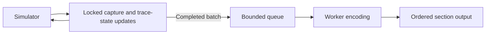

# VTR 3 producer profiling

The C++20 reference performs substantial work on the thread calling the writer,
even when encoding workers are enabled. Reducing this work is necessary to meet
the [rationale's](RATIONALE.md) requirement that most tracing work run off the
simulation threads. Thread safety and asynchronous output alone do not establish
that requirement.

This document inventories the implementation, explains its current placement,
and analyzes related transaction-write, worker-scaling and long-lived-owner
costs. It defines the measurements needed before changing them. The inventory
is based on source inspection; individual steps do not yet have measured CPU
shares.
It describes the experimental VTR 3 reference, not the production VTR 2 writer.
[TRANSACTIONS.md](TRANSACTIONS.md) specifies the model and format;
[VTR3_COMPARISON.md](VTR3_COMPARISON.md) records the reference provenance,
complete benchmark results and their limitations.

## Execution model

The producer is whichever thread calls the public writer. There is no separate
capture thread between the simulator and the writer. With multiple callers,
the producer mutex serializes their mutation calls through one writer.

The following analysis assumes `workers > 0`. The reference defaults to
synchronous mode, where encoding and output also execute on the caller.



The return path can include waiting for queue capacity. Workers do not acquire
the producer mutex to encode or write. They consume owning inputs and immutable
declarations, so recording can continue without exposing mutable simulator data.

Workers perform record grouping/transposition, transaction sorting, page packing,
waveform alias/transform/run construction, time-table encoding, compression,
checksums and ordinary section output. Per-change waveform header packing and
declaration compression are exceptions described below.

Work has three different frequencies:

- **Per call or observation:** locking, checks, capture, signal processing and
  updates to active state.
- **Per completed batch:** scans, snapshot preparation, buffer transfer,
  declaration emission and queue admission.
- **Setup or explicit control operations:** declarations, flush, close, seal and
  statistics.

A recording call that crosses a batch limit includes both the observation work
and the batch work. An owner-end call can additionally finalize many stages.
Average call cost therefore hides potentially important latency spikes.

## Calling-thread inventory

The numbered steps identify operations, not one universal execution sequence.
Signal and record calls take different branches, and several operations occur
only when a buffer fills or an explicit control method is called.

### Common call handling

| Step | Calling-thread work | Why it currently runs there |
|---:|---|---|
| 1 | Acquire the producer mutex. | Protects shared IDs, active records, signal state and capture buffers. It also establishes an order between concurrent mutation calls. |
| 2 | Check writer state and any latched worker failure. | Rejects recording after close or failure before accepting more observations. The healthy worker-failure check uses an atomic flag; propagating a failure takes additional synchronization. |
| 3 | Resolve handles and check operation kinds. | Operations need the appropriate generator, signal or active owner. Checking before mutation gives the caller an immediate argument error. |
| 4 | Return the result and release the mutex, or classify an exception. | Returned handles become immediately usable. Supported argument errors can remain retryable; unexpected allocation, encoding or I/O failures poison the writer. This exception handling does not imply an exception is thrown on healthy calls. |

The mutex covers more than inserting an item into a queue. It remains held
through the applicable capture, validation and batch-preparation operations.
If submission waits for capacity, it also remains held during that wait.

### Transactions, stages, events and logs

| Step | Calling-thread work | Why it currently runs there |
|---:|---|---|
| 5 | Look up the generator's datatype and the relevant active owner or stage. | The producer currently owns the tables used by subsequent calls to enforce lifetime rules and select payload schemas. Owner lookup uses a fixed slot table with overflow storage for displaced live owners. |
| 6 | Validate supplied payload bytes. | Ensures the payload matches the declared datatype before changing recording state. Some fixed numeric payloads require only a size check. Text, sequences, string references and packed logic can require traversal or content checks. |
| 7 | Obtain storage and capture the value. | Workers need stable input after the caller changes or destroys its objects. Borrowed bytes are copied; typed values are serialized into owning capture bytes; an owning `Bytes` final-payload overload moves storage. |
| 8 | Allocate a global record ID when creating a record. | Creation methods return IDs immediately. Later calls can attach records or relations using those IDs. Allocation also preserves the reference's common creation-order sequence. |
| 9 | Update active transaction and stage state. | Later operations consult this state to attach payloads, reject invalid lifetime operations and find stages that an owner must close. Allocation, slot displacement and hash-table updates can occur here. |
| 10 | Validate and copy optional attributes, embedded annotations and relation attributes. | Preserves caller-owned values and enforces declared keys, value types, label rules, uniqueness and payload-field collision rules where applicable. Embedded-stage updates can search the owner's stage list. |
| 11 | Record relation endpoints and update the maximum referenced ID. | Supports forward references while retaining enough state for the normal-close check against allocated IDs. This is not a full per-call scan for every endpoint's stored record. |
| 12 | Finalize a stage or owner. | Checks required payload readiness, sets status and applies the end-time policy. Owner finalization closes remaining located stages, removes active entries and fixes its completed contents. Work can grow with the owner's active stages. |
| 13 | Choose a numbered block and update the owner's located-child block list. | Owner finalization may precede child encoding and output. The owner needs stable block locators before it is handed off, regardless of worker completion order. LOG records do not enter this list. |
| 14 | Append completed records or relations and update source-buffer accounting. | Batches amortize encoding and synchronization. Byte/count limits decide when to submit them. Accounting a transaction can walk optional attributes, embedded details and child locators. |

`end_value` serializes the C++ value while holding the producer mutex, then
validates the captured bytes and finalizes the owner. Its serialization remains
inline so fixed-size captures can be optimized. The handoff representation is
canonical owning data, distinct from the eventual file columns.

Calling `capture(value)` before a writer call also performs serialization on the
calling thread, even though that work occurs outside the writer's mutex. Moving
work outside that mutex can improve concurrency without reducing the simulator
thread's total tracing CPU.

The recycler has two relevant paths: obtaining a payload usually pops a
source-local spare, while refilling spares or borrowing cached row storage
requires the pool mutex. Reuse reduces allocation pressure; it does not remove
capture or validation. Some payload-assignment methods use their current vector
storage directly rather than the recycler.

### Waveform observations

| Step | Calling-thread work | Why it currently runs there |
|---:|---|---|
| 15 | Accept the supplied waveform timestamp, check monotonicity and update the current time/table. | Later signal updates refer to this current time and its table index. The reference receives simulation time from its caller; it does not read SystemC time itself. A new timestamp can enter the table even if no signal subsequently changes. |
| 16 | Check signal handles, kinds and input representation. | Prevents invalid observations from entering capture state. A scalar-update span preflights all handles/kinds before applying updates, then uses the normal scalar path, which repeats some checks. |
| 17 | Normalize or convert signal values. | Scalars are masked to width; packed logic can be repacked between state representations; real values are captured as exact bits. These operations establish the representation used for comparison and capture. Conversion can allocate temporary buffers. |
| 18 | Check waveform recording enablement and compare with the last value. | Disabled recording suppresses waveform observations. Persistent signals can omit redundant values; event signals retain repeated occurrences. Current deduplication state belongs to the producer. |
| 19 | Encode per-change time-index headers and append value bytes. | The current handoff contains partially encoded per-signal streams, including time-index deltas and compact-value markers. This is encoding work performed before worker submission. |
| 20 | Update previous values, indices, per-signal counts and source-buffer statistics. | The next emission uses that state for deduplication and delta construction. Byte/count thresholds determine when the current waveform batch is full. |

These steps vary by representation. A two-state scalar of at most 64 bits has
a direct path. Wide or multistate values can require repacking, scanning for
two-state compactness and copying a full previous value. Real and variable-length
signals use their own capture paths. Their costs should be profiled separately.

### Batch preparation and submission

| Step | Calling-thread work | Why it currently runs there |
|---:|---|---|
| 21 | Scan completed record/TX batches for time bounds. | Section submission receives bounds used in the directory and query filtering. The reference calculates them before handoff. |
| 22 | Obtain an immutable datatype/generator snapshot and capture the current string-count limit. | Workers must retain the declarations applicable to their batch while new declarations are added. The snapshot is cached; copying and its memory scan occur when the cache has been invalidated. The string limit is captured by value. |
| 23 | Move completed record/transaction buffers into owning batch objects. | Transfers input lifetime to the encoding job. Rows generally move without a deep copy, but wrapper allocation and later replacement of source storage still cost work. |
| 24 | For waveform batches, walk signal columns, move frames/headers/values, copy descriptors and predecessor information, and initialize the next frames. | The old block becomes self-contained while the producer retains the correct state for the next block. Preparing next frames copies retained values, including quiet signals; this path walks the signal table. |
| 25 | Calculate conservative queue memory charges. | Admission needs an estimate of retained input and encoding/output expansion. Record/TX charging traverses rows and nested storage; waveform charging traverses columns. This can repeat traversal already performed during capture or batch preparation. |
| 26 | Emit pending declarations. | Strings, META, hierarchy and datatypes must precede uses. Declaration serialization runs on the caller, as does compression of applicable string/hierarchy payloads. Already serialized section payloads can also be copied into owning queue storage. |
| 27 | Allocate the queue job, acquire the queue mutex, check capacity, account it and notify workers. | Publishes a stable job in submission order and enforces the count/charged-byte limits. This queue mutex is separate from the producer and recycler mutexes. |
| 28 | Wait when queue capacity is unavailable. | Provides bounded backpressure without silently dropping observations. The queue mutex is released while sleeping; the outer producer mutex is retained. An individually oversized job waits for an empty queue and runs exclusively. |

Declaration emission can be triggered by a record/TX submission or a waveform
flush. It is conditional work, not compression of declarations on every signal
call. The native `declarations()` method also revalidates META attributes on
entry, even when no new META section is needed; profiling should distinguish
this repeated checking from actual declaration construction.

Queue charges remain until section output and output-buffer release. Recycling
input after encoding does not immediately make its queue charge available.
The charge is a conservative admission estimate, not an exact process-RSS
measurement. Source buffers, active owners, locators, declarations, allocator
overhead and codec workspace have additional lifetimes.

### Setup, control operations and observation of statistics

| Step | Calling-thread work | Why it currently runs there |
|---:|---|---|
| 29 | Construct the writer, generate recording identity, open the file and write its header. | Establishes output and recording identity before observations can be accepted. This is startup work. |
| 30 | Create declarations, intern strings and bind types. | Returns usable handles/types, validates declarations, updates hierarchy and invalidates schema snapshots. Adding a signal can first flush the existing waveform block so its signal layout remains fixed. Borrowed metadata/type views require external serialization. |
| 31 | Update clocks, classification and recording enablement. | Clock operations maintain stretch state and finalize clock records; status/span-kind changes update active records; recording enablement appends blackout transitions. Separate clock-block policy can trigger additional submissions. |
| 32 | Execute explicit `flush()`. | Submits partial batches and waits for accepted output. It is a completion operation, so its calling thread can block even with workers enabled. |
| 33 | Execute `close()`, `seal()` or destruction. | Normal close checks readiness, finalizes active records, drains and joins workers, then constructs/writes the directory and trailer and closes the file. Seal preserves incomplete provenance; poisoned shutdown abandons pending work. Destruction can invoke these paths. |
| 34 | Execute `stats()` or `handoff_stats()`. | Producer statistics take the producer mutex and can walk active owners/details to count retained payload bytes. Queue statistics take the queue mutex. These are explicit observations, not scans performed on every emission. |

The final directory's serialization, checksum and output happen on the caller
after workers stop. Ordinary record/waveform section encoding and output run on
workers in asynchronous mode. The backend's optional periodic-commit path is
disabled by the default `commit_interval_ms = 0` configuration used here.

## Why these operations are on the producer

The current implementation keeps active trace state and partially encoded
waveforms on the producer, then submits completed blocks. That choice makes
immediate argument errors, synchronous returned handles, owner finalization and
block locators straightforward. It also makes the caller responsible for much
more than capturing an observation.

Requirements on the writer's interface must be distinguished from the present
placement of its implementation:

| Requirement to preserve | Consequence for a different placement |
|---|---|
| Workers must not read simulator data after it changes. | Copy or transfer a stable representation before the call returns, or explicitly change the ownership contract. Merely queuing a pointer to a borrowed object is insufficient. |
| Creation methods return immediately usable IDs. | Reserve IDs before return, or change the interface to use another handle scheme. Detailed record assembly need not necessarily happen alongside allocation. |
| Invalid arguments are currently reported synchronously and supported errors are retryable. | Moving validation to workers changes when errors appear and what later calls may already have been accepted. That requires an explicit error model. |
| Same-time events, ordering, ownership and clock facts must survive. | An ordered operation stream could let a worker own more state. The format does not itself require producer-side deduplication, time-header packing or active-record tables. |
| Owner locators and declaration-before-use ordering must remain correct. | Moving block construction requires ordered assignment and completion rules before the owner is encoded. Keep that complexity inside the writer implementation. |
| Capture and queued memory must remain controlled under overload. | Raw-operation batches need their own accounting and oversized-item policy. Moving work can increase queue input volume, particularly if deduplication happens later. |

The producer mutex is one implementation of consistent shared state. Removing
it without relocating or partitioning that state would introduce races. An
ordered capture/worker seam is a design candidate, not evidence that all current
locking or producer-side checks can simply be deleted.

## Existing measurements and their meaning

The recorded two-worker study used a shared CPU set of `{0,1,2}` for both
synchronous and asynchronous variants. These are medians from complete runs;
the estimated tracing share subtracts a null-producer baseline.

| Workload | Process CPU, ms | Calling-thread CPU, ms | Estimated tracing CPU on caller |
|---|---:|---:|---:|
| core | 122.95 | 101.29 | 70.7% |
| soc | 507.67 | 366.92 | 61.5% |
| idle | 70.46 | 51.51 | 63.3% |
| requests | 65.74 | 35.41 | 47.3% |
| many-generators | 106.65 | 57.74 | 46.8% |
| mixed | 58.39 | 40.65 | 61.0% |

Two stale Volna unit-test processes had six spinning threads allowed on CPUs
0–19 during these measurements. They were stopped after the study. The values
describe a shared desktop host under that load; absolute throughput, small
differences and the CPU-share estimates need an idle-host rerun.

The benchmark obtains process CPU from `getrusage(RUSAGE_SELF)` and the calling
thread's CPU from `getrusage(RUSAGE_THREAD)` near the end of the operation.
These are cumulative CPU totals, not separate capture-phase measurements.
For writes they include generation, writer construction, capture, close,
statistics and destruction, plus startup overhead. The wall-time capture field
covers the producer generation loop, including tracer work and stalls.

With `P` the median calling-thread CPU, `T` the median process CPU and `N` the
median null-producer process CPU, the report computes:

```text
estimated caller tracing share = (P - N) / (T - N)
```

The medians come from separate measured runs; this is an overhead estimate,
not a per-function profile. Null subtraction assumes generation costs remain
comparable. Cache, allocator and scheduling interactions need not subtract
cleanly.

In particular:

- A 70% share does not mean 70% simulation slowdown or 70% of elapsed time.
- It does not identify which inventory step consumed that CPU.
- Time sleeping for a mutex, queue capacity or worker completion contributes to
  wall latency but little calling-thread CPU.
- The queue's wait counter measures admission waits, not producer-mutex waits
  or all time spent in flush/close.
- Two workers do not establish two concurrent encoders. Median peak encoding
  occupancy was one in the recorded default runs. This observation alone does
  not distinguish insufficient submissions, admission limits or other causes.

## Transaction write throughput

### Measured gap

The existing transaction-only workloads exercise the same logical facts across
the backends. V3 stores the five request values in a shared declared structure;
V2 uses numeric attributes. The V3 capture value is five `u64` fields, or 40
canonical bytes. These workloads have no located stages or events, so their
regression cannot be attributed to recording additional located observations.
The full metric tables are in the comparison's
[existing workload results](VTR3_COMPARISON.md#existing-workload-results).

Seven paired trials on CPU 0 measured:

| Workload | V2 write, ms | V3 write, ms | V3 time change | V2 / V3 file, MiB |
|---|---:|---:|---:|---:|
| requests | 30.09 | 47.48 | +57.8% | 2.292 / 1.616 |
| many-generators | 55.96 | 84.45 | +50.9% | 3.775 / 2.569 |

The separate three-repeat common-format suite, also on CPU 0, measured:

| Workload | FTR write, ms | V3 write, ms | V3 time change | FTR / V3 file, MiB |
|---|---:|---:|---:|---:|
| requests | 39.49 | 47.65 | +20.7% | 4.424 / 1.616 |
| many-generators | 67.24 | 83.69 | +24.5% | 7.571 / 2.569 |

Both comparisons use synchronous producers, fast LZ4 and complete writes through
close. They have different repetition sets; the slightly different V3 medians
must not be combined as one paired trial. The background-load limitation above
applies to both sets.

V3 uses about 30–32% less space than V2 on these workloads and improves several
selective queries, but the rationale also requires faster transaction recording
than FTR. The measured implementation has not met that requirement. Smaller
output does not imply lower recording CPU: organizing data into a more compact,
selectively readable representation can require more work before output.

### Costs to distinguish

The V3 path captures a typed value, retains an ordinary transaction until it
ends, then builds schema-guided columns and independent pages. It sorts completed
owners by ID within a block, assembles generator tables and bounds, checks page
sizes, compresses pages and writes section checksums/directory entries. The
synchronous path executes those operations on the caller.

In the paired study, V3 capture-loop wall times were 46.67 ms for requests and
83.39 ms for many-generators, while close took 0.59 and 0.88 ms. This places most
elapsed time before final close, but **does not isolate per-observation capture**:
synchronous block encoding and output occur inside that same loop whenever a
buffer fills. A short close does not establish that encoding is cheap.

| Area | Concrete implementation work | Evidence needed to attribute the gap |
|---|---|---|
| Writer interface and adapter | Begin/end calls, producer locking, active-handle maps and final typed capture. | Calling-thread samples and matched adapter measurements; count calls and allocations rather than assigning the whole gap to locking. |
| Payload representation | Capture into canonical bytes followed by traversal into file columns. | Bytes read/written and CPU in capture versus column construction. The fixed numeric request schema takes the size-only validation fast path, so expensive recursive validation is not established as its cause. |
| Active-owner lifecycle | Slot/overflow access, readiness checks, completed-record construction and buffer insertion. | Costs versus active-owner count, completion order and payload size, with the same source observations. |
| Paged TX encoding | Sorting, generator tables, 33 columns, page bounds/framing and possible checkpoint/restore/re-encoding near a page limit. | CPU samples, page/row counts and re-encoding counters; separate fixed per-page overhead from per-value work. |
| Storage management | Payload and row allocations, copying/moving, source accounting and queue-charge scans when workers are enabled. | Allocation traffic and visited-byte/row counts, including benefits already supplied by the recycler. |
| Compression and output | Page codec work, CRC, section framing and buffered section flushes. | Encoding/output intervals, compressed/raw sizes and CPU; small files alone do not exclude codec or output overhead. |

V2 and FTR adapters have their own capture and encoding costs. The comparison
does not prove that a shared typed schema or paging intrinsically causes the
entire regression. The implementations and interfaces differ, so attribution
requires controlled changes and complete validation, not subtracting unrelated
function timings from the final totals.

### Evaluation priorities

First separate construction, capture/lifecycle, TX encoding, compression/output
and finalization. Use CPU samples alongside phase timings so synchronous work
triggered by a full batch is attributed to its actual function. Then evaluate
the largest measured costs, including capture-to-column traffic, repeated scans,
page framing and allocation.

Keep datatype widths, exact values, duplicate occurrences, identity, optional
attributes, relations and selective-query behavior unchanged in each trial.
Report file size, query latency, memory and producer cost alongside write time.
An encoding-only improvement is useful evidence, but adoption still needs a
complete FTR/V2 comparison and representative simulator measurements.

## Worker scaling

### What configured worker count means

Two workers provide capacity for two encoding jobs; they do not guarantee that
two jobs are eligible or available at once. The implementation has several
distinct limits:

| Stage | Limit on useful overlap |
|---|---|
| Producer preparation | Calls serialize through the producer mutex, and completed blocks arrive only after capture and batch preparation. Workers can run out of eligible input. |
| Admission | Both job count and conservative charged bytes must fit. A queue with fewer than eight jobs can still be full by bytes. An oversized job runs exclusively. |
| Encoding | At most the configured number of workers encode concurrently. Queue and recycler synchronization, scheduling and memory traffic can add costs. |
| Ordered output | Only one worker writes the next submission sequence at a time. Later encoded results remain ready until earlier work is written. That worker is occupied by output rather than encoding another job. |
| Charge release | Queued, encoding, ready and writing jobs retain their charge until output completes. A slow earlier job or write can delay admission even if later encoders have finished. |

The median peak number of simultaneous encoders was one in the final default
two-worker runs. This is a peak counter, not average worker utilization, a
time-weighted occupancy measure or a count of all active encoding/output work.
It cannot alone identify which stage limited overlap.

The five-repeat final comparison illustrates workload dependence:

| Workload | Shared CPU 0: sync / two workers, ms | Shared CPUs 0,1,2: sync / two workers, ms |
|---|---:|---:|
| requests | 47.71 / 56.35 | 47.34 / 47.34 |
| many-generators | 84.11 / 98.14 | 84.65 / 66.94 |
| mixed | 49.57 / 53.95 | 49.73 / 51.63 |

Worker mode can overlap one encoder with the producer even when two encoders
never overlap. Conversely, more threads on one CPU can add scheduling,
allocation and synchronization cost. Neither observation establishes a general
speedup or regression for a different simulator's workload.

These variants also select different policies: synchronous TX encoding defers
exact page-size scans, worker TX encoding scans exactly after each row, and the
default recycler budget is zero synchronously versus 16 MiB with workers.
Waveform adapters use scalar calls synchronously and time-step spans with
workers. Their bytes/facts are validated, but the timing difference is a
comparison of configurations, not an isolated measurement of adding threads.

### Why charged bytes matter

The current TX estimate combines retained input capacity with an encoding
estimate multiplied by 12, plus declaration-snapshot charges. The per-owner
encoding estimate includes a fixed allowance, ten times payload size, optional
attributes, embedded details and locators. Waveform and RECORD estimates have
their own conservative expansion allowances.

The declaration snapshot is charged per job even when multiple jobs share the
same snapshot object. That further separates charged bytes from the distinct
storage actually retained by concurrent jobs.

For example, the payload contribution alone for a 40-byte request is
`40 * 10 * 12 = 4,800` charged bytes before other allowances. That is accounting
for anticipated work/storage, not a claim that capturing that payload occupies
4,800 resident bytes. This conservatism can prevent two data jobs from fitting
under the default 256 MiB charge budget.

Charges also remain after input recycling until output completes. A completed
encoder therefore does not immediately make its entire charge available to the
next producer submission. Job counts include small declaration jobs as well as
data jobs, so several queued jobs do not imply several eligible data encoders.

### What doubling the queue demonstrated

An earlier frozen-reference experiment ran seven shuffled pairs with two
workers on CPUs `{0,1,2}`, changing only the charged-byte limit from 256 to
512 MiB. Both variants used the same executable and retained the eight-job
limit. This experiment predates the final reference snapshot; its values are
incremental evidence, not substitutes for the final medians above.

| Workload | Write, ms: 256 / 512 MiB | Peak encoders: 256 / 512 MiB | Admission wait, ms: 256 / 512 MiB | Writer RSS, MiB: 256 / 512 MiB |
|---|---:|---:|---:|---:|
| requests | 51.44 / 49.44 | 1 / 2 | 4.58 / 0.37 | 23.25 / 26.26 |
| many-generators | 73.58 / 73.23 | 1 / 1 | 2.12 / 0.00 | 22.49 / 22.48 |

Wait and peak-encoder values are medians of per-run counters; RSS is the maximum
writer peak across repetitions. Requests improved about 3.9% in wall time while
process CPU increased from 68.03 to 69.72 ms. Many-generators changed about
0.5% despite removing its measured admission waits. Waveform and mixed results
showed little benefit. Small effects remain provisional under the host load.

The requests result supports the conclusion that byte admission restricted some
encoding overlap in that experiment. It does not establish admission as the
dominant end-to-end cost. The many-generators result shows that removing those
waits alone was insufficient to create two concurrent encoders or substantially
improve throughput. Retaining the smaller default was a measured resource
tradeoff, not proof that the accounting policy is optimal.

### Measurements and changes to evaluate

Trace job preparation, submission, admission, encode start/end, ready state and
write start/end with job IDs. Record time spent in each state, not just maxima.
Correlate producer stalls with those intervals and separately measure producer
mutex wait/hold times. This distinguishes input starvation, byte admission,
encoder CPU, ordered-output delay and actual output service time.

Test worker count, batch size and byte/job limits independently under fixed CPU
budgets. Hold page-framing, recycler, capture and codec policies constant when
isolating scheduling; separately report complete intended configurations.
Include a longer steady-state workload so startup and tail drain do not dominate.

Potential changes include reducing measured batch-preparation costs, refining
charge bounds, choosing batches that allow useful overlap, and reducing ordered
output's occupation of encoder workers. Each needs an end-to-end comparison.
Lower charges require evidence about retained/expanded storage across codecs,
ragged payloads and failures; an observed RSS value is not itself a safe upper
bound. More queued bytes can increase memory without increasing useful work.

## Long-lived owner costs

### Retained writer state

Completed located child payloads leave their owner when submitted. The owner
still retains its own payload/attributes, embedded annotations, active stages
and the distinct block numbers containing located children. Queue limits do not
bound these lifetimes while the owner remains active.

Let `B` be the number of distinct located-child blocks touched by one active
owner and `N` its completed located children. The locator vector contains `B`
64-bit numbers: at least `8 * B` logical bytes, plus capacity slack and allocator
overhead. Multiple children in the same block add only one entry. In the worst
case each child lands in a different block, so `B = N`. With several active
owners, retained locator storage grows with the sum of their touched-block
counts, not just the current queue depth.

This is substantially smaller than retaining every completed child payload,
but it is not constant memory. Embedded events/stages remain inside the owner
until finalization and can grow independently. Ending the owner then accounts,
encodes and stores its complete payload, embedded detail and locator list. One
owner stays together in a TX page; an oversized owner can exceed ordinary
source/page targets rather than being split across those targets.

The reader's primary-payload reconstruction limit does not cap all embedded
detail, locator storage or outstanding expansion results.

Measure active state separately from buffered jobs and recycled storage. Track
locator count/capacity, embedded bytes, active-stage count and owner-end latency
against both elapsed lifetime and observed child/block volume. Time alone does
not determine retained memory: a long quiet owner can be cheap.

### Owner expansion path

`Reader::expand(id)` currently performs these operations:

1. Resolve the ordinary owner through the decoded-owner cache or candidate
   TX blocks/pages. Block ID ranges can overlap when old owners finish beside
   recent owners; there is no exact global owner-ID-to-row index.
2. Follow each child block number through the block-number map. A missing block
   is retained in the result's incompleteness report.
3. Scan the referenced block's segment headers, excluding LOG segments and
   rejecting parent ranges that cannot contain the requested owner.
4. Decompress each selected page once for that query. Other segments sharing
   the page incur decompression even if their records need not be decoded.
5. Decode every row and its typed payload in each selected segment, then test
   the exact parent ID and copy matching records into the owning result vector.
6. Sort the collected located records by global ID and return the owner,
   matching records and missing-block information.

Parent ranges are conservative. For example, a referenced block can contain:

| Segment | Actual parent IDs | Parent bounds | Expansion of owner 42 |
|---|---|---|---|
| A | 2, 90 | 2–90 | Selects the segment, decodes it, finds no matching parent. |
| B | 42, 43 | 42–43 | Selects the segment and retains owner 42's rows. |

The locator establishes that the block has some child of owner 42; it does not
identify which page, segment or row. Broad ranges can therefore amplify work
inside a genuinely relevant block. Ownership does not imply temporal containment,
so the owner's interval cannot safely exclude all children outside that interval.

For an already opened reader, the cost can be separated as:

```text
expansion time = owner lookup + referenced-header scans
               + candidate-page decompression + candidate-segment decoding
               + matching-record copies + result sorting
```

A cold-query benchmark additionally includes reader preparation and destruction.
Reading or checksumming compressed bytes is also distinct from decompression:
full section CRC verification can touch the whole selected section. Independently
compressed pages do not make that integrity check page-sized.

### Cached owners do not cache located expansion

The reference retains parsed block/page/segment headers, decoded ordinary owners
and waveform histories. `RecordBlockView::query` uses page-local decompressed
buffers and releases them after the query. There is no cross-query record-page
cache or cached owner-to-located-child result. A repeated expansion can reuse
its owner while decompressing and reconstructing located records again.

The decoded-owner cache defaults to 4,096 entries and 32 MiB of accounted data.
An owner larger than its cache byte budget is returned without being retained
there. Caller-held owning references survive eviction, and an expansion's
located-result vector is separate from that cache budget. Bounding cache
retention does not bound the memory of all outstanding caller results.

The one-CPU longtail workload attaches 30,000 families to one dispatch, yielding
120,000 located stages/events. Each expansion benchmark retains the owner plus
all those located records on both versions before checksumming them:

| Implementation | Cold expansion p50, ms | Warm expansion p50, ms | Cold expansion process peak RSS, MiB |
|---|---:|---:|---:|
| V2 | 22.65 | 22.53 | 50.94 |
| V3 synchronous | 14.44 | 14.24 | 22.91 |

These are three-repeat measurements with filesystem-warm input under the same
host-load caveat. Cold opens a reader for each probe; warm reuses a reader with
available caches, with open cost reported separately. RSS is the process maximum
across repetitions, not isolated result-vector allocation. V3 improves on V2,
but materializing 120,000 records still consumes time and memory. Similar
cold/warm medians do not by themselves quantify the contribution of any one
decode, copy, allocation or sorting step.

There are two different targets: avoid decoding unrelated evidence and control
the unavoidable cost of returning matching evidence. A finer index can reduce
the first cost; returning all `N` matching records still requires work and owning
storage proportional to their contents. Logs and ordinary children are separate
queries and must be charged separately when a consumer requests them.

### Measurements and changes to evaluate

For each expansion record referenced blocks, headers tested, pages/bytes
decompressed, candidate rows/payload bytes decoded, matches returned, sorting
time and peak result storage. Compare candidate work with matches and result
bytes; distinguish a low-selectivity query from a poor index for a small result.
Measure repeated owners, different owners sharing pages, disordered completion,
large payloads and recovered files, with cold and warm decoded caches.

| Candidate | Potential benefit | Cost or invariant to preserve |
|---|---|---|
| Bounded record-page cache | Avoids repeated decompression across queries. | Retains additional memory, needs accounting/eviction, and does not eliminate parsing or result copies by itself. Cold queries still pay setup/decompression. |
| Transient parent-to-record/page index | Amortizes repeated parent searches after decoding. | Building and retaining it costs CPU and memory; results must preserve every distinct occurrence and valid payload lifetime. |
| Parent-first filtering with payload skipping/projection | Avoids allocating full payloads for unrelated rows or unused fields. | Typed column cursors and dictionaries must still advance correctly; full validation must retain its integrity checks. |
| Persistent finer owner locators | Selects pages/segments more directly than block ranges. | Adds file metadata and writer bookkeeping. Page placement is established during encoding, so forward owner references require additional coordination before owner serialization. |
| Streaming or paginated owner results | Controls caller result memory and supports incremental consumption. | Must specify ordering and completeness; it does not itself remove unrelated decompression or make a complete traversal constant-time. |

Evaluate reader caches and indexes against complete location-plus-label and
owner navigation, not only one isolated lookup. Charge construction, write
overhead, storage and retention alongside query gains. Any new locator/index
scheme must preserve stable IDs, children outside owner time bounds, ordinary
children outliving their parent, missing-block reports and incomplete provenance.

## Profiling plan

### Establish a clean baseline

Inventory host processes outside the sandbox process namespace before each
study. Record competing CPU work, affinity, compiler/build hashes, codec,
worker count, source limits and queue/recycler budgets. The prior stale tests
were invisible to a process listing inside the execution sandbox.

Repeat the complete existing workloads with source/read/query oracles, both
synchronously and with workers, under the same CPU budgets. Preserve shuffled
paired ordering and every metric. Include complete drain and close. Use the
same observed facts when changing capture representation or batching.

### Separate CPU work, lock waits and backpressure

| Measurement | What it should resolve |
|---|---|
| Process and per-thread CPU deltas for construction, generation/capture and close | How much of the calling-thread total comes from steady recording versus setup/finalization. |
| Calling-thread CPU samples with call stacks | Which capture, validation, allocation, conversion, bookkeeping and batch functions actually consume CPU. |
| Producer-mutex wait and hold distributions | Whether callers contend, and which operations create long critical sections. Measure one caller and multiple callers separately. |
| Per-call wall latency by operation, including batch-boundary calls | Whether small average overhead hides frame preparation, owner finalization or queue-wait spikes. |
| Queue occupancy, admission waits, encode/write intervals and drain time | Whether workers are starved, limited by admission, blocked behind output, or simply have little work to overlap. |
| Allocation counts/bytes, captured/copied bytes and recycler hits | Whether storage reuse reduces allocator work and how much copying remains. Distinguish current retained capacity from allocation traffic. |
| Rows, nested values and signal columns visited by scans | Whether accounting, validation, schema snapshots or next-frame construction scale with total state instead of changed observations. |

Start with sampling and existing coarse counters. Timestamping every scalar
emission can dominate the cost being measured. Any added instrumentation needs
an overhead comparison against the same uninstrumented build. Inclusive nested
function costs must not be added together as independent CPU totals.

### Exercise the dimensions hidden by one aggregate score

- **Signal representation:** two-state scalars, wide/multistate vectors, real
  bit patterns and variable-length values.
- **State versus activity:** many quiet signals, many attempted unchanged
  emissions, dense changes and repeated same-time events. Count attempted calls
  separately from retained changes.
- **Payload shape:** fixed numeric structures, strings, sequences, nested
  aggregates and large payloads. Distinguish serialization from validation.
- **Lifetime shape:** many active owners, many active stages per owner,
  long-lived owners and accumulated embedded annotations/locators.
- **Declaration churn:** fixed declarations versus late types/generators/signals
  that invalidate snapshots or force waveform flushes.
- **Concurrency and overload:** one or several callers, batch/scalar calls,
  queue saturation and exclusive oversized items.
- **Codec policy:** stored, fast LZ4 and the reference's default Zstandard
  level 1. Existing throughput comparisons select fast LZ4.

Keep source-oracle checks outside the timed region where the existing harness
does so, while retaining complete write timing and subsequent validation. Small
diagnostic studies can explain a cost; they do not replace complete workload
comparisons or representative simulator measurements.

## Changes to evaluate after profiling

These candidates follow from the inspected implementation. Their order should
be determined by measured cost and end-to-end benefit.

| Candidate | Potential benefit | Constraint or tradeoff |
|---|---|---|
| Incremental bounds and memory accounting | Removes repeated batch/nested-storage scans. | Updates must cover every mutation, nested allocation and oversized item; conservative charges must remain safe. |
| Capture larger spans into reusable storage | Amortizes locking and allocation. | Callers need a practical batch lifetime; payloads still need stable ownership and capacity limits. |
| Move waveform deduplication, conversion and header packing to a worker | Reduces per-emission calling-thread processing. | Preserve event duplicates, exact values and ordering; raw submissions can substantially increase queued volume. |
| Move active-record assembly behind an ordered operation handoff | Reduces producer-side lifetime bookkeeping and owner-end bursts. | Preserve returned IDs, synchronous versus deferred error behavior, owner auto-close, clock semantics and locators. |
| Share immutable declaration state more directly | Reduces snapshot copying and caller-side declaration construction. | Old batches must retain the exact declaration view they need; file declarations must precede uses. |
| Narrow or partition producer synchronization | Allows independent callers to overlap capture. | Requires a clear ownership/order model for shared state, not merely replacing the mutex primitive. |

A successful change reduces calling-thread cost or latency while preserving
observations and controlling memory. Evaluate total CPU, wall throughput,
backpressure, file size, query costs and final drain together. A lower caller
CPU percentage can result merely from spending more CPU on workers; it is not
by itself an improvement in simulator overhead.

## Source map

Paths are relative to the temporary reference root `atemp/vtr3-reference` in
the Volna workspace. The frozen implementation/adapter source hashes are listed
by the build manifest identified in [VTR3_COMPARISON.md](VTR3_COMPARISON.md).

| Source | Relevant implementation |
|---|---|
| `include/vtr3/vtr.hpp` | Public writer options, mutation interface and inline `end_value`. |
| `src/writer.cpp` | Producer mutex/error handling, active records, payload validation/capture, clocks, block assignment, locators, record/TX batch preparation and close. |
| `include/vtr3/schema.hpp`, `src/schema.cpp` | Canonical typed capture, datatype traversal and payload validation fast/general paths. |
| `src/payload_pool.hpp` | Shared recycler mutex, payload/row capacity retention and transfer to source-local spares. |
| `native/src/writer.cpp` | Scalar/general waveform capture, `set_time`, `reset_column`, `flush_waves`, declarations, section output and final directory construction. |
| `src/handoff.cpp` | Admission accounting, condition-variable waits, worker execution, ordered output, failure propagation, drain and join. |
| `src/transactions.cpp` | TX sorting, column assembly, framing/checkpoints, page compression and candidate-page reads. |
| `src/reader.cpp` | Decoded-owner cache, ID lookup, owner expansion, owning result construction and sorting. |
| `src/records.cpp`, `src/container.cpp` | Parsed block/header maps, parent-range pruning, per-query page decompression and row/payload reconstruction. |
| `benchmarks/benchmark.cpp` | Wall capture/close timing and cumulative process/calling-thread CPU measurements. |
| `benchmarks/writers.hpp`, production `vtr/benchmarks/writers.hpp` | Typed V3 versus V2/FTR workload adapters and their capture policies. The production path is relative to the Volna root. |
| `experiments/queue-capacity-three-cpus/raw.json` | Seven-pair byte-budget experiment, per-run queue counters and preserved executable identity. |
| `navigation/navigation.cpp`, `experiments/delivery-navigation-one-cpu/raw.json` | Equivalent retained navigation results, source oracle and longtail query measurements. |
| `write_final_report.py` | Null-subtracted caller-share calculation and reported medians. |
