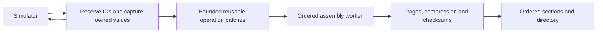

# VTR transactions 3.1

Status: experimental C++20 reference in `atemp/vtr3.1` in the Volna workspace.
Production readers and writers remain VTR 2. Regenerate trace assets when adopting
3.1; the reference accepts container version 3.1 only.

This proposal retains the transaction model in [TRANSACTIONS.md](TRANSACTIONS.md)
and changes the capture boundary and the encoding of a common transaction case.
The requirements remain [RATIONALE.md](RATIONALE.md), including located stages
and events, stable occurrence identities, typed reusable payloads, incremental
recovery, and selective access through either owners or locations.

The measured fast-LZ4 configuration beats FST/FTR in write time and file size on
every common workload, and moves most estimated tracing CPU off the producer in
all eleven measured profiles. Some one-CPU workloads remain slower than V3.0;
the measurements below distinguish the competitor target from that tradeoff.

## What the previous results establish

[VTR3_COMPARISON.md](VTR3_COMPARISON.md) demonstrates useful waveform compression
and much faster selective transaction navigation. It also shows transaction
writes about 21–25% slower than FTR on the two common transaction workloads.
The smaller transaction files do not compensate for missing the writer target.

[ProducerProfiling.md](ProducerProfiling.md) explains why adding compression
workers is insufficient. The producer owns active records, validates and copies
payloads, constructs waveform delta headers, scans batches, and maintains child
block locators. Workers receive already assembled blocks. The recorded producer
shares of estimated tracing CPU are 61–71% on waveform/mixed workloads and about
47% on transaction workloads. Conservative job charges further limit encoding
overlap. Increasing a queue limit cannot eliminate work before that queue.

Those measurements had competing host activity and are not an idle-host baseline
for this experiment. Comparisons below rerun complete workloads on the current
host. A sampled profile of the first 3.1 operation-stream implementation also
identified allocation, duplicate mutex operations, transaction sorting, and
scalar traversal as material costs. Moving operations alone reduced producer
CPU but initially made complete writes slower.

## Ordered capture before record assembly



The primary configuration has one assembly worker and no additional encoding
workers. Both producer and worker share the CPU budget used by the competitors;
the single-CPU comparison gives their complete process one logical CPU.
Additional encoding workers remain available for experiments, but are not
required to obtain the reported writer result.

The simulator thread reserves a monotonically increasing global ID, captures
canonical owned values, and appends an operation. It does not maintain active
owner/stage tables, validate payload contents against the schema, normalize or
deduplicate waveform values, pack waveform time headers, allocate child blocks,
or assemble output pages. The ordered worker performs those operations using
the existing semantic implementation. It checks that its allocated identities
match the producer's reserved IDs.

Borrowed text, byte arrays, packed values, and update spans are copied before
return. Worker operations contain offsets into owned batch storage, never
pointers into simulator objects. Typed capture writes declaration-order fields
without copying C++ object padding. Fixed aggregates reserve their canonical
space once; variable aggregates use the general serializer.

Ordinary producer methods serialize concurrent callers with a producer mutex.
`Producer::Capture` holds that mutex across a batch of calls, amortizing locking
for a single simulator producer. The common benchmark holds one capture lease
through its replay. Other producers wait for the lease; this is not evidence of
scaling independent simulator threads. Release a lease before calling ordinary
producer methods, declarations, statistics, flush, or close.

The assembly worker has exclusive access to backend mutation state between
barriers. Its backend capture mutex is disabled only through the private
ownership transfer performed by `Producer`. A barrier waits for assembly to
become idle before a control call accesses that state. This ownership rule is
necessary to avoid replacing producer-side locking with a data race.

### Error, declaration, and completion contracts

An accepted operation is an ordered fact awaiting validation, not a promise that
semantic validation has completed. Invalid ownership, payloads, signal handles,
timestamps, or lifetime operations poison the operation stream when the worker
encounters them. The latched exception surfaces at a subsequent recording call
or a barrier. Operations following the invalid operation may already have been
accepted; callers must not retry an accepted ID or operation after this failure.

This explicitly replaces V3's synchronous, retryable semantic-argument errors
for the asynchronous producer. The direct `Writer` remains useful for synchronous
validation and low-level format tests. Typed capture can still reject an invalid
capture size before publishing an operation.

Declarations, string interning, datatype binding, embedded-record control calls,
and attributed relations use barriers in this reference. They remain valid
during recording. Previously accepted operations complete before the control
operation executes; declarations precede every later use. These infrequent
operations can still perform substantial work on the simulator thread. Borrowed
metadata/type views require external serialization while they are being used.

`flush()` drains accepted operations and then flushes the backend. `close()`
drains, joins assembly, verifies ordinary completion, drains any encoding workers,
writes the final directory/trailer, and closes output. All of this is included in
write timing. Explicit flush is needed when a producer requires queued observations
to be recoverable before a crash; an unpublished partial capture batch exists
only in memory.

On failure, assembly stops at the failing operation and wakes blocked producers.
`seal()` preserves available evidence with incomplete provenance. Destruction
seals an unclosed producer rather than manufacturing successful completion.
Recovery still validates independently framed sections and reports unresolved
owners, children, and relations; a reserved ID is not itself a durable record.

### Capture and memory budgets

The default operation ring contains four reusable batch objects, including the
producer's current batch and a batch being executed. A batch is submitted after
its operation headers plus captured bytes reach 1 MiB. Backpressure waits for a
recycled batch; it never discards observations or allocates an unbounded chain
of new batches. Batch counts and admission-wait counts/times are reported
separately from the backend's encoding-queue counters.

An observation can cross the byte target. A batch exceeding twice the target
forces a drain, and arena/vector capacities above twice the target are released
after execution. The target is not a hard RSS ceiling: vector capacity rounding,
one large captured observation, backend buffers, codec workspace, declarations,
and active records have separate costs. Variable payload size must therefore
remain part of a producer's capacity budget.

The producer defaults to 16 MiB of backend payload reuse. The backend retains its
4 MiB record/TX source target, 64 KiB raw page target, and 16 MiB waveform source
target. Optional encoding workers retain their separately bounded handoff; that
queue does not substitute for the operation-ring limit.

Completed located payloads are released independently of their owner's lifetime.
An active owner still retains its own payload, embedded detail, active stages,
and distinct child-block locators. For an owner touching B child blocks, the
locator list remains O(B), not constant memory. This proposal does not claim to
remove long-lived-owner metadata or the cost of materializing all matching
children.

## Encoding changes

The container header stores little-endian major version 3 and minor version 1.
The recording identity, section framing/CRC, block numbers, directory, type
declarations, hierarchy, waveform bodies, RECORD_BLOCK bodies, and general TX
columns retain their V3 definitions. The source-bound activity sidecar retains
its independent 3.0 framing and matches the new trace's identity and finalized
fingerprint; no old-container reader fallback is introduced.

The primary new wire encoding is an alternative raw TX page for transactions
with a small fixed payload made entirely from unsigned 64-bit scalar leaves.
Byte planes let LZ4 exploit field similarity without per-value varint conversion
and without changing the declared values. Rich transactions, signed/narrow
payloads, floating values, sequences, text, embedded detail, and relations retain
the general schema-guided encoding.

### Scalar TX pages

The TX_BLOCK header, sorted generator table, page headers, independently
compressed blobs, and query bounds are unchanged. Each decompressed page begins
with either the existing varint column count 33, or discriminator byte 2 for the
layout below. Other discriminators are invalid.

```text
u8  discriminator = 2
u32 payload_type_id
u32 row_count
repeat 6 + payload_word_count times:
    u8 width
    width byte planes, each containing row_count bytes
```

Integers in this description use little-endian fixed width unless a field says
otherwise. The payload datatype is a fixed aggregate of zero or more scalar
leaves whose effective primitive is `u64`, `time`, or `pointer`; enums with an
unsigned-64 underlying type qualify. Its canonical byte size is a multiple of
eight and at most 2,048 bytes. `payload_word_count` is that size divided by eight,
derived from the declaration and not repeated in the page.

| Column | Unsigned value |
|---|---|
| 0 | Absolute global record ID |
| 1 | Index in this block's generator table |
| 2 | Absolute begin time |
| 3 | Duration, `end - begin` |
| 4 | Absolute parent ID, or zero |
| 5 | `(span_kind << 4) \| status` |
| 6 onward | Canonical payload words in declaration order |

All page rows are ordinary transactions with the declared payload type. Optional
attributes, embedded events/stages, and child-block lists are empty; the page
contains no relations. A parent need not be absent. Generators, ownership,
classification, times, and payloads obey all the usual validation rules.
Transactions with located-child locators use the general layout.

`width` is the smallest number of bytes sufficient to represent the largest
value in that column, from zero through eight. Zero means all values are zero
and stores no plane bytes. For nonzero width, the last plane must contain a
nonzero byte. Plane j contains byte j of every row's value, in row order:

```text
plane[j][i] = (column[i] >> (8 * j)) & 255
```

Rows have strictly increasing IDs within and across this block's pages. Widths,
counts, type eligibility, generator/type agreement, duration overflow,
classification, parentage, and decoded page bounds are validated. The body must
be consumed exactly. The reader retains plane views and reconstructs one record
at a time; it does not materialize a page-sized matrix of decoded transactions.

The reference selects this layout only when a complete TX input batch qualifies
and contains no relations. Otherwise it uses general pages. For K columns, its
conservative row target is
`max(1, floor((page_bytes - min(page_bytes, 9 + K)) / (8 * K)))`.
This bounds ordinary scalar pages by the raw target without repeatedly scanning
column lengths. As with general pages, one row may exceed a deliberately tiny
configured page target.

### CPU changes without additional wire semantics

For densely allocated ID ranges, transaction sorting uses a bounded slot array
and a linear scan. The array is used only when the ID range is less than four
times the row count; sparse ranges retain comparison sorting. Duplicate IDs
remain errors. This preserves sorted output and avoids an index proportional to
the largest file-wide ID.

Unsigned-word schemas also have a direct-load path in the general argument
encoder. Reusable payload buffers avoid a new allocation for every completed
owner. These optimizations preserve declaration order and canonical values;
they do not special-case benchmark field names or discard observations.

The common benchmark adapter derives its serial-to-ID mapping directly, as its
FTR adapter already does, and verifies each returned creation ID. Its source
generator, completion schedule, payload values, and independent source oracle
are unchanged. The removed adapter hash table is part of the measured improvement
and must not be attributed solely to the wire layout.

## Located stages, events, and navigation

Located stages/events remain separate RECORD_BLOCK rows with their own global
IDs, owner IDs, and generator locations. Selecting an owner and selecting a
location lead to the same stored occurrence. Coincident identical events are
distinct; overlapping visits remain evidence. Ordinary children may outlive
their parent and located children need not be temporally contained by it.

The worker assigns child-block numbers and finalizes the owner's locators before
serializing that owner. Ordered operation execution preserves parent creation,
stage completion, owner auto-close, forward relations, and declaration ordering
without simulator-side block assignment. A scalar page cannot omit a required
child locator because such an owner fails scalar-page eligibility.

Location/time selection, full owner values/labels, expansion, ordinary children,
logs, relations, ID lookup, and clocks are checked against independent producer
replay. Cold and warm queries retain the complete requested results and charge
reader preparation appropriately. Coarse child-block locators and the existing
owner cache remain; expansion can still decode unrelated candidate rows, and
returning N matches still requires O(N) output work and storage.

## Measurements and validation

The reference's reports and raw measurements live under
`atemp/vtr3.1/experiments`. Writes include source generation, capture, backpressure,
assembly, encoding, compression, checksums, indexing, final drain, and close.
Buffered I/O is used; fsync and power-loss durability are not measured. Reads and
queries follow writing, so the OS file cache is warm. RSS comes from a fresh
process's VmHWM. Binary codecs use fast LZ4; stored/LZ4/Zstandard correctness is
tested separately.

The source workloads are the six unchanged default profiles and the five
owner/location profiles from the V3 evaluation. Comparisons use deterministic
shuffled order and verify every complete read and all twelve probes of every
applicable query against source replay. The common suite compares FST/VCD,
FTR, and paired waveform/transaction outputs; the implementation comparison
additionally reruns V3.0. No throughput result for FTR implies that FTR provides
the native located-record API.

Measured on the Intel Core Ultra 7 265K, Linux 7.0.0-38, GCC 15.2.0,
C++20 `-O3 -DNDEBUG`, with the complete process pinned to CPU 0. Five
shuffled common-format repetitions, seven shuffled V3.0/3.1 pairs, and three
shuffled navigation repetitions all completed with matching source/read/query
digests. Process listings are limited to the available execution namespace;
they do not establish that the entire desktop host was idle.

| Workload | 3.1 write ms | Competitor | Write ms | Speedup | 3.1 / competitor MiB |
|---|---:|---|---:|---:|---:|
| core | 121.03 | FST | 603.14 | 4.98× | 7.695 / 8.941 |
| soc | 444.01 | FST | 797.82 | 1.80× | 24.579 / 52.345 |
| idle | 65.05 | FST | 109.47 | 1.68× | 1.733 / 4.165 |
| requests | 33.53 | FTR | 36.74 | 1.10× | 0.989 / 4.424 |
| many-generators | 51.85 | FTR | 63.68 | 1.23× | 1.352 / 7.571 |
| mixed | 42.18 | FST+FTR | 81.88 | 1.94× | 1.939 / 4.010 |

**The writer-speed and file-size gates pass on every measured common workload.**
These are controlled fast-LZ4 synthetic results, not a claim about every payload
representation, codec, simulator, or machine. VCD is an additional reference;
its per-workload results are retained in the complete report. V3.1 takes 9–19%
less write time than FTR on the two transaction profiles and produces files
78–82% smaller. The corresponding throughput speedups are 1.10× and 1.23×.

| Workload | V3.0 / 3.1 write ms | V3.0 / 3.1 file MiB | V3.0 / 3.1 writer RSS MiB |
|---|---:|---:|---:|
| core | 119.78 / 122.47 | 7.695 / 7.695 | 18.94 / 23.88 |
| soc | 422.34 / 462.00 | 24.579 / 24.579 | 16.02 / 20.72 |
| idle | 58.31 / 67.77 | 1.733 / 1.733 | 15.36 / 21.12 |
| requests | 42.99 / 33.79 | 1.616 / 0.989 | 11.84 / 16.48 |
| many-generators | 78.44 / 52.69 | 2.569 / 1.352 | 11.90 / 17.21 |
| mixed | 45.02 / 43.66 | 2.192 / 1.939 | 19.80 / 26.26 |

The operation ring intentionally adds retained capture storage. Its copying,
synchronization, worker drain, and the loss of the single-thread allocator path
can increase waveform wall time versus V3.0 on one CPU. These costs buy a much
smaller producer CPU burden; they are charged in the table, rather than hidden
in an enqueue-only measurement. Waveform bytes remain unchanged apart from
container framing/recording identity. Transaction byte planes reduce both write
cost and size. Full reads and every query metric, including p50/p95, CPU, counts,
and peak RSS, are retained in `accepted-paired-v3/report.md`.

| Common workload | Process / producer CPU ms | Estimated tracing CPU on producer | Capture-ring wait ms |
|---|---:|---:|---:|
| core | 121.72 / 55.96 | 11.3% | 50.29 |
| soc | 444.74 / 153.78 | 5.7% | 283.50 |
| idle | 65.58 / 30.00 | 25.4% | 28.61 |
| requests | 34.16 / 12.28 | 17.5% | 17.72 |
| many-generators | 52.39 / 20.44 | 17.1% | 27.99 |
| mixed | 42.72 / 19.98 | 25.6% | 15.66 |

The estimate is `(producer CPU - null CPU) / (process CPU - null CPU)`, using
separate medians. It includes generation and startup in the measured CPU totals;
subtraction is an overhead estimate, not a per-function or phase CPU profile.
Waiting contributes to capture wall time but little producer CPU. Every capture
batch is accounted as completed after close; full report counters expose stalls.

| Located workload | V3.0 / 3.1 write ms | 3.1 file MiB | Estimated producer tracing CPU | Cold track / labels / expansion ms |
|---|---:|---:|---:|---:|
| balanced | 23.90 / 30.64 | 0.486 | 29.3% | 0.050 / 1.472 / 1.256 |
| longtail | 20.53 / 28.16 | 0.546 | 33.4% | 0.049 / 0.067 / 12.705 |
| logburst | 27.02 / 35.31 | 0.300 | 33.1% | 0.033 / 0.647 / 0.389 |
| disordered | 24.06 / 30.94 | 0.493 | 28.8% | 0.095 / 2.973 / 1.351 |
| large | 43.21 / 45.43 | 0.380 | 12.8% | 0.062 / 0.951 / 0.692 |

Every measured common and located profile puts most estimated tracing CPU off
the simulator thread. The located adapter uses a capture lease, direct typed
arena capture, and a flat list of active interval kinds instead of an allocating
tree. These caller-side changes are included in its timings. Small located
records can still cost more wall time than V3.0 under the one-CPU budget;
removing that overhead for every workload is not demonstrated. The complete
navigation report includes all cold/warm track, label, expansion, ordinary-child,
log, relation, identity, and clock metrics.

All 20 reference test groups pass in Release, ASan+UBSan, and ThreadSanitizer
builds; the new capture/lease/attribute/oversized paths also pass targeted
sanitizer reruns. LeakSanitizer is disabled in this environment. Production V2
passes all five native interoperability/invariant/recovery groups and its full
three-repeat default suite. The 490-metric production comparison has no missing
metrics and identical reported file sizes; V2 code is unchanged. Its current
write/read medians improve versus the committed report, consistent with the changed host
load described in the earlier study. No production throughput claim is inferred
from the proposal.

Final artifacts: `accepted-default/raw.json`, `accepted-default-report.md`,
`accepted-paired-v3/raw.json`, `accepted-paired-v3/report.md`,
`accepted-navigation/raw.json`, `accepted-navigation/report.md`,
`production-metric-diff.json`, and `accepted-build.json` under the experiments
directory. Build/source hashes and a source archive preserve the measured
reference. Earlier experiment directories are exploratory configurations.

Twenty reference test groups cover the inherited model, independent Python
schema/record/TX/activity decoders, an independent Rust waveform reader,
failure/recovery, and the new operation stream and byte-plane layout. The new
layout has independent stored/LZ4/Zstandard decoding plus malformed count,
width, truncation, trailing-byte, and payload-limit tests. The capture tests
exercise borrowed-data lifetime, repeated events, auto-closed stages, late
aggregate declarations, concurrent callers, bounded batch recycling, and
deferred failure with incomplete sealing.

Passing synthetic comparisons establishes a measured configuration and workload
boundary. It does not establish calibrated C910, SystemC, GPU, wide/multistate,
real-valued, or declaration-churn throughput. Late declarations and embedded
control operations still use simulator-thread barriers. Active owner state and
coarse navigation remain independent memory/query tradeoffs. Production adoption
requires integrating the new producer contract and measuring representative
simulator rates.

## Reproduction and source map

From the Volna workspace, after building the repository's pinned benchmark
dependencies:

```sh
python3 atemp/vtr3.1/build_benchmarks.py
ctest --test-dir atemp/vtr3.1/build --output-on-failure
python3 atemp/vtr3.1/benchmarks/run.py --cpu 0 --repeats 5 \
  --output atemp/vtr3.1/experiments/recheck-default
python3 atemp/vtr3.1/benchmarks/compare.py \
  atemp/vtr3-reference/benchmarks/.build/benchmark --cpu 0 --repeats 7 \
  --output atemp/vtr3.1/experiments/recheck-v3
python3 atemp/vtr3.1/navigation/build.py
python3 atemp/vtr3.1/navigation/run.py --cpus 0 --repeats 3 \
  --output atemp/vtr3.1/experiments/recheck-navigation
```

Output directories must be new. The navigation comparison uses the preserved
V3.0 executable as well as the current V2 library and 3.1 reference. Benchmark
manifests record executable/source hashes, compiler flags, and pinned dependency
revisions. Temporary reference sources and artifacts are intentionally untracked.

| Reference path | Responsibility |
|---|---|
| `include/vtr3/producer.hpp` | Owned operation batches, capture leases, IDs, barriers, backpressure, error propagation, and assembly lifetime |
| `include/vtr3/schema.hpp` | Padding-free fixed/general typed capture |
| `src/writer.cpp` | Semantic validation, active records, owner locators, and backend batches |
| `src/scalar_page.hpp`, `src/transactions.cpp` | Scalar page eligibility, byte planes, bounded dense-ID sorting, and selective streaming decode |
| `src/records.cpp`, `src/reader.cpp` | Located rows and complete owner/location navigation |
| `native/src/writer.cpp`, `native/src/reader.cpp`, `src/container.cpp` | Version-3.1 framing, unchanged waveform bodies, and prefix recovery |
| `tests/producer_test.cpp`, `tests/scalar_page_test.cpp`, `tests/scalar_oracle.py` | Operation-stream invariants and independent new-page validation |
| `benchmarks`, `navigation` | Complete common-format and owner/location comparisons |
